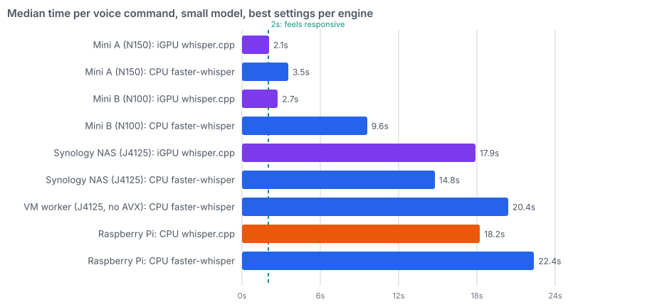
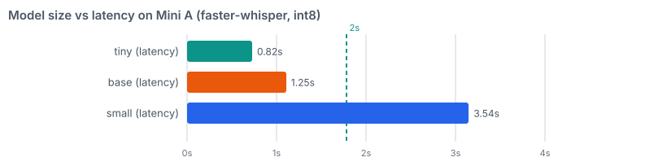
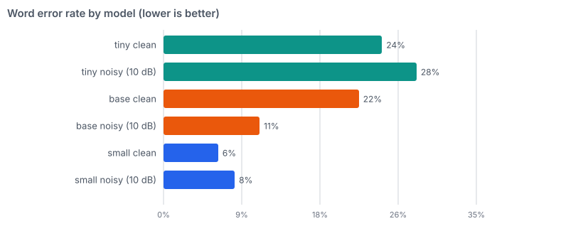
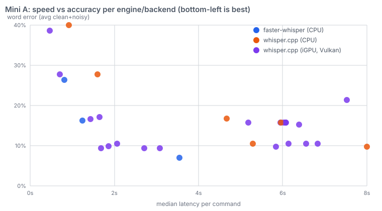
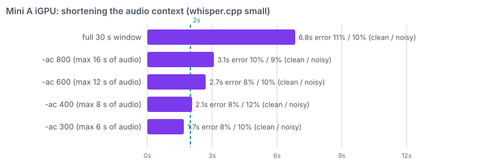
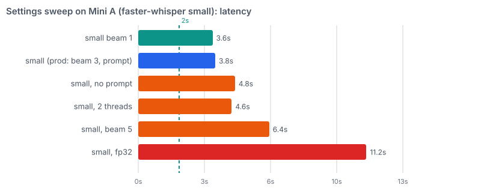

# Voice benchmark — speech-to-text speed and accuracy

[← Back to Home](../Home.md) · Smarthome: [Voice](voice.md) · Plan: [Fast Whisper TODO](../06-todo/whisper-upgrade.md)

The goal behind this benchmark is a **fast, responsive home voice assistant**: say a command, have the
light react without an awkward pause. Speech-to-text (Whisper) is the slow step, so this page measures how
long one short Dutch command takes on every kind of hardware in the lab, how many words it gets wrong, and
which settings matter. Run on 2026-11-01. The scripts are in `scripts/voice-bench/` so the whole thing can be
re-run (see [Re-running](#rerun)).

## Verdict {#verdict}

- **Fastest usable setup: `whisper.cpp` with the `small` model on the iGPU of the N150 mini node, with a
  shortened audio context (`-ac 400`).** About **2.1 s** per command, **8 % / 12 %** word error (clean / noisy).
  The other mini's iGPU does the same in 2.7 s. This is the setup the [TODO](../06-todo/whisper-upgrade.md)
  plans to build.
- **Easy fallback: `faster-whisper` `small` on the same node's CPU**, today's image and settings: **3.5 s**,
  **6 % / 8 %** error. It needs only a node pin, no new software.
- The same job on the mini that used to run whisper takes 9.6 s on the CPU, and **15–22 s on the Raspberry Pi,
  the VM worker and the NAS**. Those are not usable for voice, even with their GPU or a faster engine.
- Smaller models are quick but wrong too often: `tiny` and `base` miss 11–38 % of words.
- Settings that matter: **a shortened audio context** (the big speed-up, no accuracy loss) and **the initial
  prompt** (halves the errors in noise). Beam 5, fp32 and fewer threads than cores only make things slower.

## How to read the numbers {#reading}

- **Latency (p50)** is the median time from sending a finished audio clip to getting the text back, with the
  model already loaded and warmed up. This is what you feel as "pause after speaking", on top of the
  wake-word, network and Home Assistant time. **Max** is the slowest clip of the run; a big gap between p50
  and max means jittery behaviour.
- Whisper always processes a padded 30-second window, so latency is almost flat for 2 s and 5 s commands: a
  short command is *not* proportionally faster. That is why only a smaller model, faster hardware or a
  shortened context helps.
- **Word error rate (WER)** is the percentage of reference words that were wrong, missing or extra, after
  lower-casing and removing punctuation. 0 % is perfect. On a 5-word command, one wrong word is 20 %, so
  small differences are lumpy. Home Assistant matches entity names fuzzily, so a few percent of WER does not
  mean failed commands; 20 %+ usually does.
- **Clean vs noisy**: each phrase was run clean and with synthetic pink noise at about 10 dB signal-to-noise
  (a TV or kitchen in the background). A setup that is fine clean but collapses noisy is a bad fit for a living
  room.
- Lower latency *and* lower WER is strictly better; the interesting choices are on the speed/accuracy
  frontier (bottom-left of the engine chart).

## Results {#results}

### Best configuration on every platform {#platforms}

`small` model, beam 3, the production initial prompt, 4 threads (3 on the VM worker which has 3 vCPUs). The
`whisper.cpp` rows use `-ac 400`. 12 test clips each (4 on the NAS `whisper.cpp` rows, which are slow).



| Platform | Engine and device | p50 | max | WER clean / noisy |
|---|---|---|---|---|
| Mini A (N150) | `whisper.cpp`, **iGPU** | **2.06 s** | 2.6 s | 8 % / 12 % |
| Mini A (N150) | `faster-whisper`, CPU | 3.54 s | 4.0 s | 6 % / 8 % |
| Mini A (N150) | `whisper.cpp`, CPU | 5.29 s | 6.4 s | 8 % / 12 % |
| Mini B (N100) | `whisper.cpp`, iGPU | 2.73 s | 3.9 s | 8 % / 12 % |
| Mini B (N100) | `faster-whisper`, CPU | 9.59 s | 14.3 s | 6 % / 8 % |
| Mini B (N100) | `whisper.cpp`, CPU | 11.0 s | 15.6 s | 8 % / 12 % |
| Synology NAS (J4125, Docker) | `faster-whisper`, CPU | 14.8 s | 16.1 s | 6 % / 8 % |
| Synology NAS (J4125, Docker) | `whisper.cpp`, iGPU | 17.9 s | 19.8 s | 10 % / 13 % |
| Synology NAS (J4125, Docker) | `whisper.cpp`, CPU | 102 s | 105 s | 10 % / 13 % |
| VM worker (J4125, no AVX) | `faster-whisper`, CPU | 20.4 s | 22.4 s | 6 % / 8 % |
| Raspberry Pi (Arm, 4 cores) | `whisper.cpp`, CPU | 18.2 s | 27.4 s | 8 % / 12 % |
| Raspberry Pi (Arm, 4 cores) | `faster-whisper`, CPU | 22.4 s | 28.7 s | 6 % / 8 % |

What stands out:

- The iGPU is **2.6× faster than the CPU** on Mini A and **4× on Mini B**, with the same `whisper.cpp` accuracy.
- Accuracy follows the model and the engine, not the hardware: the same configuration gives the same word
  error on every machine. `faster-whisper` is slightly more accurate than `whisper.cpp`.
- On the NAS CPU class (J4125, no AVX instructions) everything is slow; the iGPU helps `whisper.cpp` 5.7×, but it
  still ends up no better than `faster-whisper` on the CPU. The VM worker runs on the same NAS host and has the
  same CPU.
- The Pi is slow with any engine; `whisper.cpp` is only about 20 % better there.

### Model size {#models}

`faster-whisper` on Mini A, int8:





`tiny` and `base` are fast but wrong too often to trust for commands (24 % and 22 % error on clean speech on
the fastest node); `small` is the first model that is reliably right. `medium` (10.6 s) and `large-v3-turbo`
(15.1 s) are far too slow on these CPUs, and on the iGPU `medium` still takes 5.8 s (9 % / 10 %) while the
quantised `large-v3-turbo` takes 7.5 s with erratic clean-speech error (36 %): not worth it for commands.

### The iGPU in detail {#igpu}



Each dot is one configuration on Mini A (engine, device, model, audio context, beam, prompt). Bottom-left is
best. The iGPU dots (purple) cluster in the low-latency corner; `faster-whisper` `small` (the blue dot near
3.5 s / 7 %) is the best accuracy but slower.

**Audio context.** Whisper pads every clip to 30 s; `whisper.cpp` can be told to look at fewer audio frames
(`-ac N`, where N frames are `N × 0.02` s of audio). This is where the speed-up comes from, with no change in
accuracy for commands:



The cap is hard: `-ac 400` is 8 seconds, and a longer command is cut off. All test commands were under 5 s.

**Initial prompt.** On `small` with `-ac 400`, beam 3: without the prompt the error was 8 % clean / 26 % noisy;
with the home-automation prompt 8 % / 12 %. The prompt is the single biggest accuracy lever in noise.

**Other iGPU switches** (flash attention off, fp16 off, temperature fallback off) changed neither the text nor
the accuracy, and the iGPU and the CPU produced identical transcripts for identical settings. So the GPU is
numerically fine on this hardware.

**Why the first iGPU numbers looked unstable.** An earlier pass reported bimodal timings (about 1 s for some
clips, 6–7 s for others) and erratic accuracy. That was a benchmark bug, not the GPU (see
[Pitfalls](#pitfalls)); the clean re-run shows every request in one narrow speed band.

### Settings sweep on Mini A (CPU engine) {#settings}



`faster-whisper` `small`, latency only (the raw result files of this sweep were lost before scoring, so accuracy
is known only for the three-model baselines above). The ranking on the other mini matched.

### Real voice check {#real-voice}

After the deployment, the same ten phrases were recorded by a person with the laptop microphone
(`scripts/voice-bench/record.sh`, quiet room; the recordings stay local, they are not in git) and run through the live
`whisper-cpp` service on the iGPU:

| | Median per command | Word error |
|---|---|---|
| Real voice, the six clips the benchmark used | about 2.2 s | **8.0 %** |
| Real voice, all ten clips | 2.1–2.8 s | 10.5 % per clip (8.7 % pooled) |
| Synthetic voice, clean (benchmark) | 2.1 s | 8 % |

The longest real command was 4 s, well under the 8 s `-ac 400` limit. Four clips had a wrong word (`luiken` as
"luik", `plafondspots` as "Plafonspot", `slaapkamer` as "slaakkamer", "en zet" as "ze"), six were perfect. The scorer
counts "19" for "negentien" as an error, which Home Assistant does not care about. The other mini gave 2.0–3.8 s
on the same clips. Not yet done: the noisy-room pass (`record.sh noisy`).

## Method {#method}

- **Audio**: ten Dutch smart-home phrases (1.6–4.9 s) in `scripts/voice-bench/phrases.txt`, generated with the
  cluster's own Piper voice, converted to 16 kHz mono, plus a copy of each mixed with pink noise at about 10 dB
  SNR. Six phrases × clean/noisy = 12 clips per configuration. The audio is synthetic and one voice: use the
  numbers to **rank** setups, not as absolute real-world accuracy.
- **Engines**: `faster-whisper` 1.2.1 (CTranslate2 4.8.2) inside the same `wyoming-whisper` image production runs;
  `whisper.cpp` 1.9.x `whisper-server` (prebuilt Vulkan image on the minis and the NAS iGPU, a portable
  no-AVX build for the VM worker and the NAS CPU, a pod-compiled build on the Pi).
- **Measured**: model loaded first, two warm-up requests (the first request after start compiles GPU shaders),
  then each clip timed once; the median of 12. Output text scored with a word-level edit distance against the
  phrase.
- **Resource limits used** (requests were small, limits are the ceiling):

| Test pod | CPU limit | Memory limit | Notes |
|---|---|---|---|
| Mini A, Mini B, Pi | 4 cores | 4 Gi | production whisper was 4 cores / 1.5 Gi |
| VM worker | 3 cores | 2.2 Gi | all its vCPUs |
| `whisper.cpp` Vulkan pods | 4 cores | 4–6 Gi | `/dev/dri` mounted, privileged |
| NAS container | none | 3 Gi | `/dev/dri` passed through |
| `whisper.cpp` build pod | 4 cores | 6 Gi | 3 Gi was OOM-killed |

Memory peaks (resident) were about 0.4 GB for tiny, 0.65 GB for base, 1.2–1.35 GB for small, 3 GB for medium
and 3.6 GB for large-v3-turbo.

- Production whisper was scaled to zero during the run (via git, see the [TODO](../06-todo/whisper-upgrade.md))
  so it would not compete for CPU.

## Pitfalls hit while benchmarking {#pitfalls}

- **A leaked server poisoned the first `whisper.cpp` numbers.** The script started each configuration's server
  with `eval ... &` and stopped it with `kill $pid`, which killed only the wrapper shell. The old server kept
  running and kept port 8099, so a later configuration's requests were sometimes answered by an *older*
  configuration's server (other model or settings), giving bimodal speed and erratic accuracy. It also leaked
  memory until the pod was OOM-killed after about ten configurations. Fix (in `wcpp.sh`): `eval exec`, then
  `pkill whisper-server` after each configuration, and assert no server is left. Every `whisper.cpp` figure on
  this page comes from the fixed script; the first-pass numbers were discarded.
- **Do not exec heavy work inside a production pod.** Running Piper inside the live Piper container hit its
  memory limit and OOM-killed it. Use a throwaway pod.
- **Results kept only inside a pod are lost** when the pod finishes or is OOM-killed (this happened several
  times). The harness prints one JSON line per clip and results are pulled out as they grow.
- **The prebuilt `whisper.cpp` images crash with "Illegal instruction"** on CPUs without AVX (the VM worker and
  the NAS). Fix: build with `-DGGML_NATIVE=OFF -DGGML_AVX=OFF ...` (`build_portable.sh`; a Vulkan build needs
  `libvulkan-dev glslc spirv-headers` and about 6 Gi of memory). The crashed server also produces fake results: a
  latency near 0.0002 s with empty text. `analyze.py` drops such rows.
- **`whisper.cpp` has no arm64 image** for the Pi; compile it in a pod.
- **A container with `/dev/dri` mounted as a plain `hostPath` cannot use the GPU** (Vulkan reports "No devices
  found"); the device must be granted to the container. The benchmark used a privileged pod; the plan uses the
  Intel device plugin instead.
- **Docker on the NAS** needs root; the user is not in the docker group. The scratch directory and containers
  were created with sudo and removed afterwards.
- A long job in a single `kubectl exec` stream dies on its own; run it detached inside the pod and pull the
  output file instead.

## Re-running {#rerun}

All scripts are in `scripts/voice-bench/`. They use the `smarthome` namespace, label every pod `bench=voice`
and keep results in local files. Replace `<node-name>` with a node's k3s name (`kubectl get nodes`).

1. **Make the audio** (about 2 minutes): `cd scripts/voice-bench && ./gen-audio.sh`
2. **Free the node** if needed. To stop production whisper, set `replicaCount: "0"` in its values (a string,
   the lib treats integer 0 as unset) and push, then undo it afterwards.
3. **Start a bench pod** per node (limits are the ceiling): `./mkpod.sh bench-a '{"kubernetes.io/hostname":"<node-name>"}' 4 4Gi`
4. **Copy audio and script in, then run detached**, then pull the output:

   ```bash
   kubectl -n smarthome exec bench-a -- mkdir -p /audio
   tar cf - -C audio . | kubectl -n smarthome exec -i bench-a -- tar xf - -C /audio
   kubectl -n smarthome exec -i bench-a -- sh -c 'cat > /tmp/bench.py' < bench.py
   kubectl -n smarthome exec bench-a -- sh -c 'cd /tmp && nohup /usr/src/.venv/bin/python bench.py minia 4 tiny,base,small 1 > /tmp/run.log 2>&1 &'
   kubectl -n smarthome exec bench-a -- cat /tmp/run.log > fw_minia.log   # lines starting with "R " are results
   ```

   Arguments: label, threads, comma-separated model specs, repetitions. A spec can carry options:
   `small+b1` (beam 1), `small+noprompt`, `small+fp32`, `small+t2` (2 threads).
5. **`whisper.cpp` / iGPU**: `./mkcpp.sh cpp-a <node-name> ghcr.io/ggml-org/whisper.cpp:main-vulkan 4 4Gi 1`
   (last argument `1` mounts `/dev/dri`), copy `wcpp.sh` and the audio in, download the `ggml-*.bin` models from the
   `ggerganov/whisper.cpp` Hugging Face repo into `/models` (`dl.sh`), then run detached, for example
   `/matrix.sh minia "small gpu 400 3 1" "small cpu 400 3 1" > /tmp/m.tsv` (copy `matrix.sh` in as well; it runs one
   `wcpp.sh` per configuration and prints `servers_left=0` after each, which must stay 0). Config fields: model,
   `gpu|cpu`, audio context (0 = full, 400 = short clips), beam, prompt (1/0). Environment: `IDS="03 06"` tests
   fewer clips, `REPS=3` repeats each, `EXTRA="-nfa"` adds server flags, `TAG=x` labels the run. `expsum.py <tsv>`
   summarises a quick experiment (p50, fast/slow split, WER) without needing the node ids. On CPUs without AVX use
   the portable build (`build_portable.sh`).
6. **Score and chart**: name the result files `fw_<id>.log` and `wcpp_<id>.tsv`, where `<id>` is one of
   `minia minib pi vm nas` (the ids are hard-coded in `analyze.py` and `charts.py`; edit those lists if your
   hardware differs), run `python3 analyze.py` from the folder holding the files and `phrases.txt` (prints latency
   and WER, writes `res/summary.json`), then `python3 charts.py <outdir>` (writes the SVGs used above).
7. **Clean up**: `kubectl -n smarthome delete pod -l bench=voice`, remove any NAS scratch directory and
   containers, remove the images you pulled (`crictl rmi` on the node), and revert the whisper replica change.

## Limits of this benchmark {#limits}

- 12 clips per configuration (4 for the slow NAS `whisper.cpp` rows), one synthetic voice, one noise type: good
  for ranking, too small for percentage-point claims.
- No real microphone audio, no wake-word or Home Assistant time included.
- The settings sweep and the `medium` / `large-v3-turbo` CPU rows are latency-only or partial.
- Mini A and Mini B differ in chip generation and in how busy the node is; the CPU-engine gap between them
  (3.5 s vs 9.6 s) was not split into those two causes. The iGPU gap is much smaller (2.1 s vs 2.7 s).
