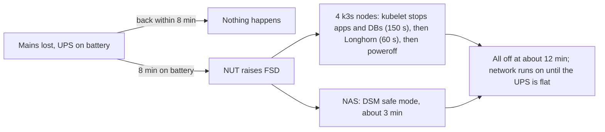
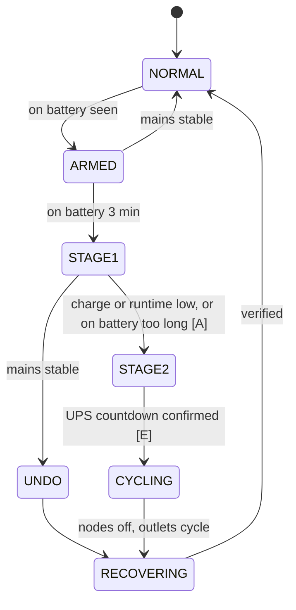
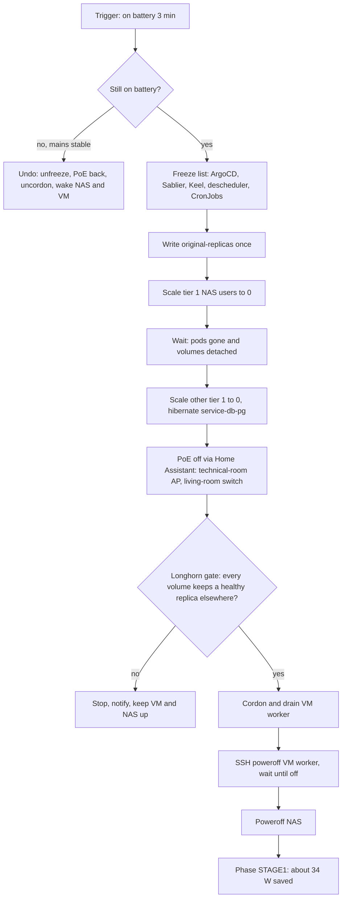
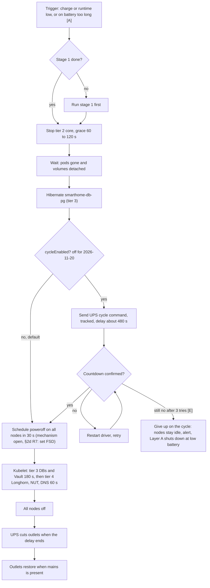
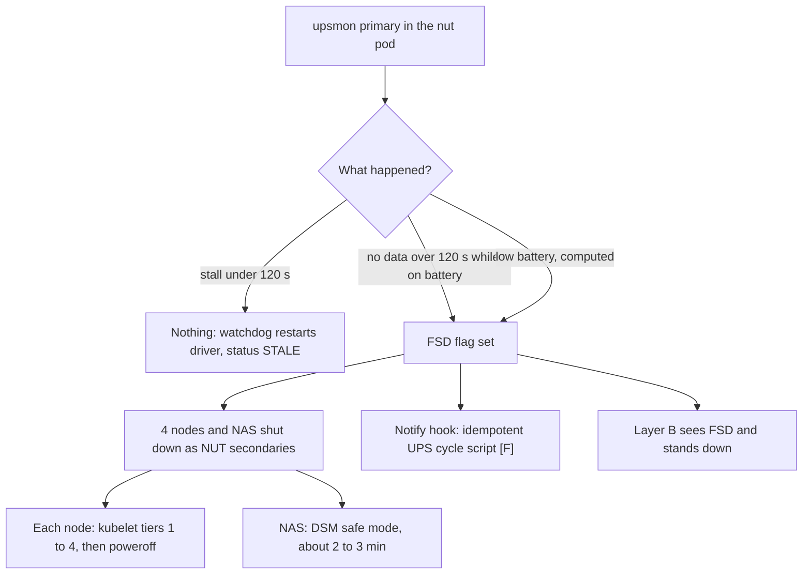
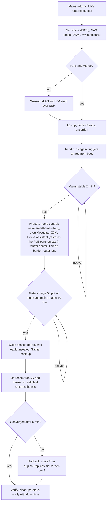

# UPS shutdown — the plan on one page

[← Back to Home](../Home.md) · Detail, evidence and review table: [UPS graceful shutdown](ups-graceful-shutdown.md) · Related: [Power / NUT](../01-platform/power-nut.md)

> **Status (2026-11-18): current plan = "Layer A only"** (below). Everything after it (Layer B, shed groups, PoE, recovery
> phases, the 2026-11-20 schedule) is the **paused** full design, kept for when the UPS is replaced: the battery measured
> past end-of-life (~18 min real runtime) and no NUT-compatible replacement is buyable yet (waiting for the EcoFlow River
> 520 Gen4 with confirmed NUT support, EU Q1 2027). Evidence and decisions: [detail page](ups-graceful-shutdown.md) §0, §2c,
> §2d. 2026-11-20: manual clean shutdown by the owner. Delete this page together with the detail page once built and moved
> into [Power / NUT](../01-platform/power-nut.md).

## Current plan: Layer A only

When the UPS has been on battery for **8 minutes**, the NUT server raises **FSD** and every host shuts itself down
cleanly. Nothing is changed in git or the cluster, so after power returns everything just boots and starts as usual.



| Piece | What |
|---|---|
| Trigger | `upssched` in the `nut` pod: 8 min on battery → FSD (a timer, because the UPS's % is badly optimistic); LB as backstop; `DEADTIME 120` so the driver hiccups never trigger it |
| Nodes | NUT client (`upsmon` secondary) → `poweroff`; kubelet graceful shutdown by existing priority: priority 0 (apps + DBs) 150 s, then Longhorn/system 60 s; logind delay ≥ 210 s |
| NAS | existing DSM NUT client, UPS support re-enabled |
| Databases | CNPG `smartShutdownTimeout: 30` |
| Gap (accepted) | mains back after the hosts are off but before the UPS is flat → hosts stay off, power them on by hand |

Build and test steps, timing and the UPS replacement status: [detail page §0](ups-graceful-shutdown.md#0-current-plan-layer-a-only-2026-11-18).

---

*The full design (paused) follows.*

## 1. Goal and ground rules

1. **A power outage must never cost data.** Runtime is secondary.
2. Shed what nobody needs first, stop everything in dependency order, then **cycle the UPS** so every host sees a real
   "power came back" event and boots by itself.
3. Two layers: **Layer B** (smart, ordered, fires early) and **Layer A** (dumb safety net, fires late, needs no orchestrator).
4. Git is the source of truth. The orchestrator only scales things live and remembers the original replica counts.

## 2. Layers, triggers and phases

| Layer | What | Runs where | Needs |
|---|---|---|---|
| **B** orchestrator | staged shedding, hibernate DBs, UPS cycle, recovery | one CronJob in `nut` (every minute, one copy at a time), pinned away from the VM worker, state in the `ups-state` ConfigMap; form **reopened** (§2d: Go binary with a tested core + laptop CLI now, operator later) | k3s, kubectl |
| **A** safety net | FSD → every node and the NAS shut down as NUT secondaries, kubelet stops pods in tier order | NUT primary in the `nut` pod (follows the UPS via NFD), secondaries on the 4 nodes and the NAS | k3s on the UPS node (accepted risk) |

| Trigger (all require "on battery") | Layer | Action |
|---|---|---|
| on battery seen | B | phase `ARMED`, notify, no cluster change |
| on battery for 3 min (decided, was 90 s) | B | stage 1 |
| on battery 8 min **or** battery voltage ≤ 23.5 V **or** charge < 30 % (worn battery; 10 min / 23.2 V after the swap) (measured 2026-11-17, §2d R11) **[A]** | B | stage 2 |
| low battery, computed by NUT (`ignorelb`): ≈ charge < 75 % until the new battery (UPS % is optimistic; calibrated in Test 0) **[A]** | A | FSD, shutdown in tier order |
| no UPS data for more than 120 s (`DEADTIME`) while on battery | A | FSD, same as above |
| data stale for under 120 s (driver stall, about once an hour) | — | nothing; status `STALE` is never treated as "on mains" |

Battery charge falling, left to right. Stage 1 is time based and can happen at any charge; the thresholds below are the
current values, which **[A]** says must move up once the shutdown time is measured.


Phases (`ups-state`). Before stage 2 starts, returning mains **undoes** the shedding; from stage 2 on, it always runs to the
UPS cycle and then recovers. Every step re-checks the UPS first.



## 3. Tiers — who stops when

Importance decides who goes first; dependency decides who must outlive whom. Home Assistant matters most to you but still
stops before its database and storage. The same four tiers drive Layer B (scaled down in order) and the kubelet (stopped in
order when Layer A has to do it alone: Longhorn and the `nut` pod get `system-node-critical`, nodes use
`shutdownGracePeriodByPodPriority`).

| Tier | Stops | Who | Layer B | Kubelet grace |
|---|---|---|---|---|
| **1 Disposable** | first | arr stack **and its database `service-db-pg`** (only the arr stack uses it), Vaultwarden **and its MySQL**, music-assistant, slskd, cloudbeaver, ha-mcp, esphome, vscode-server, jellyseerr, tautulli, babybuddy, aws-tunnels, piper, whisper, SMB server, other `stage1` apps | stage 1 (NAS users first, then the rest, then the DBs of this tier hibernated) | 60 s |
| **2 Core** | second | Home Assistant, Zigbee2MQTT, Mosquitto, Matter server, Thread border router, Prometheus, Alertmanager, Grafana, Loki, n8n | stage 2 (`final`) | 60 s |
| **3 Databases** | third | `smarthome-db-pg` (Home Assistant's database), Vault | `smarthome-db-pg` hibernated after tier 2 | 180 s |
| **4 Plumbing** | last | Longhorn (manager, instance manager, CSI; existing `longhorn-critical` class), NUT, MetalLB speaker, Technitium DNS, the orchestrator | never touched | 60 s |


Inside tier 1, the databases (`service-db-pg`, Vaultwarden's MySQL) get a priority just above their clients ("1b"), so the
kubelet stops the apps first and the DB right after, in the same 60 s tier. They never stop in parallel with their clients.

**Worst case, Layer A alone:** 60 + 60 + 180 + 60 = **360 s** of tier grace, plus OS shutdown, plus the NAS (2–3 min, in
parallel). Grace values are ceilings; Test 1 measures the real time. This number sets the UPS cycle delay (≈ 480 s) and, via
**[A]**, the battery thresholds.

**Frozen during an outage** (`power.homelab/shed=freeze`, label-driven): ArgoCD controller + applicationset controller,
Sablier, Keel, descheduler, Reloader are scaled to 0; app CronJobs are suspended. The orchestrator is `keep`. Everything
frozen is restored from the write-once `power.homelab/original-replicas` annotation.

**Hardware shed in stage 1:** VM worker (drained, then SSH poweroff), NAS, and two PoE ports (technical-room AP,
living-room switch). Saves ≈ 34 W of ≈ 124 W. Kept: office AP, cameras, gateway, rack switch.

## 4. Stage 1 — shed what nobody needs



"Still on battery" is re-checked before every irreversible step (freeze, VM poweroff, NAS poweroff). The drain follows the
existing ansible pattern (refuse on degraded Longhorn, cordon, drain with eviction disabled). The Longhorn rebuild that may
start 300 s after the VM goes is accepted and measured in Test 1. PoE ports are shed and restored through Home Assistant (decided 2026-11-17): the orchestrator calls an HA script to switch them off in stage 1 and another to switch them on in the undo path and in recovery phase 1 (§2d R8: after a short outage HA never restarts); an HA automation on HA start stays as a fallback.

## 5. Stage 2 — stop cleanly, then cycle the UPS



With the cycle off (the default for 2026-11-20) the nodes are powered off right after the databases are hibernated; the UPS then runs on the network load until it cuts out (a real AC loss), or mains returns first and the hosts are woken by hand (Wake-on-LAN). When the cycle is enabled, its last step is the real "power came back" event that boots the minis (BIOS AC-restore), the NAS (DSM Power Recovery)
and the VM (VMM autostart). **Which UPS command does this on battery is the open question for Test 0** (`shutdown.reboot`
has a fixed 10 s delay in the NUT source; `load.off.delay <s>` is the likely candidate).

## 6. Layer A — the safety net



If k3s on the UPS node is itself broken, none of this starts. That risk is accepted (decision 4).

## 7. Recovery



A second outage during recovery is handled like a first one, because the triggers are armed from boot. Start order for
Matter: server first, Thread border router last, then up to ~15 min of device re-registration (not a failure). **Phase 1
(your home control) comes back first**: the orchestrator scales it up itself from the recorded replica counts while ArgoCD is
still frozen, as soon as mains has been stable for 2 min. Monitoring and n8n come with phase 2. Phase 2 (arr stack, Vaultwarden,
the NAS users, the ArgoCD unfreeze) waits for 50 % charge and 10 min of stable mains.

## 8. What if…

| Situation | What the plan does |
|---|---|
| Mains returns while `ARMED` | Back to `NORMAL`, nothing was changed |
| Mains returns during stage 1, NAS still on | Undo: unfreeze, PoE back, uncordon, wake CNPG |
| Mains returns after the NAS/VM are off, before stage 2 | Undo including Wake-on-LAN + VM start; the whole rack is not cycled |
| Mains returns during stage 2 | Cycle on: runs on to the UPS cycle (mains present, so outlets restart), then recovers. **Cycle off (the 20th):** nodes power off and stay off, because AC never drops; wake by hand (WoL, power buttons, replug the Pi) |
| Mains flaps | One CronJob; mains must be stable to undo or recover; the recovery gate keeps heavy steps off a weak battery |
| Driver stalls 15–40 s while on battery | Status `STALE`, no transitions, timers keep running, no FSD (`DEADTIME` 120 s) |
| Driver silent over 120 s while on battery | upsmon declares comms loss → FSD → Layer A shuts down in tier order (safe, not coordinated) |
| UPS cycle command lost | Tracked command + read-back + retry; after 3 tries nodes stay idle and Layer A shuts down at low battery **[E]** |
| Orchestrator dead or stuck | Layer A acts at low battery; the CronJob resumes from the phase when it runs again |
| k3s on the UPS node down | **No coordination** (accepted risk): nodes and NAS run until the battery dies |
| GitHub/internet down at recovery | ArgoCD cannot render; after 5 min the `original-replicas` fallback scales things back |
| NAS does not boot after SSH poweroff | Wake-on-LAN, then VM start over SSH (tested in Test 1) |

## Backup wake: ESPHome WoL node (idea)

Covers the gap where the hosts are off but the outlets never lost power (cycle failed, or mains came back early). Idea: a
small ESPHome device on a **non-UPS** mains socket. It loses power with the outage and boots when mains returns; while the
UPS-fed network is still up it sends Wake-on-LAN packets, which are harmless to hosts that are already running.

```yaml
# sketch, placeholders only
esphome:
  on_boot:
    priority: -100
    then:
      - delay: 12min        # must be longer than the UPS cycle delay + margin, else it boots hosts just before the cut
      - repeat:
          count: 15
          then:
            - button.press: wol_node_a
            - button.press: wol_node_b
            - button.press: wol_nas
            - delay: 60s

button:
  - platform: wake_on_lan
    id: wol_node_a
    name: "WoL node a"
    target_mac_address: "<mac>"
```

- **Same L2 segment.** A magic packet is a broadcast: the ESP must sit in the same VLAN as the nodes and the NAS. ESPHome
  devices elsewhere (e.g. an IoT VLAN) will not reach them. Verify the VLANs before building.
- **Timing is coupled to the cycle.** The first packet must come after the UPS has cut and restored the outlets.
- **Covers:** the two minis (NIC supports it, see below) and the NAS (WoL enabled in DSM). **Does not cover** the Pi (no WoL; it
  needs a real power loss, so check how it is powered) or the VM (started by DSM VMM autostart once the NAS is up).
- **Make WoL explicit.** The minis' NICs have magic-packet WoL enabled by the driver default; add `WakeOnLan=magic` to the
  systemd link config in ansible so it survives. BIOS-side WoL and AC-restore are not readable from the OS: test live
  (drain one mini, power off, send a packet; unplug and replug power).

## Before anything is built

| Who | What |
|---|---|
| **Test 0** (bench, bulb as load) | Which UPS command cycles the outlets with mains **absent**; its maximum delay; countdown read-back; LB flips at the raised thresholds (`ignorelb`); a driver restart does not cancel a running countdown |
| **Test 1 / 2** (dry-run, agent with safeguards: dead-man alert, phone hotspot, kubeconfig by IP) | Watts saved per rung; real shutdown time per tier (sets delay and thresholds); Longhorn rebuild after the VM goes; Wake-on-LAN + VM start; ArgoCD unfreeze on the small node |
| **You** | BIOS power-on after AC loss on both minis; DSM Power Recovery + VMM autostart; DSM UPS settings and the 2026 safe-mode events; replace the battery before trusting thresholds |

## Deadline: planned outage on 2026-11-20

**Situation.** A planned power outage on **Friday 2026-11-20, starting in the morning, lasting several hours**. That is far beyond
the battery (≈ 40 min estimate), so an orderly shutdown is certain and the UPS will most likely run flat, which gives every host a
real AC loss on the way back (no UPS cycle command needed on the day). Decision 2026-11-17: **build the full design before then**
(the recommended smaller MVP below was offered and not chosen). **Nothing is built yet.** The build starts from a fresh session on
the owner's explicit order; until then this page is the hand-off.

**Hard rules for the build session**

- Every disruptive step (node drain, k3s restart, poweroff, NAS or VM off) needs the owner's explicit OK at that moment.
- At most 2 agents at once; mechanical edits (labels across apps) to `haiku-worker`, design and anything destructive stay on the main model.
- Public repo: no real domains, IPs, hostnames, MACs or emails in any tracked file; run `scripts/validate-charts.sh` after chart edits.
- GitOps wins: change `values.yaml`, not the cluster; ArgoCD `selfHeal` reverts live patches.

### Schedule and go/no-go

| Day | Work | Output |
|---|---|---|
| Tue 17 (build) | Everything in the workstreams below that does not touch prod nodes: GitOps changes, ansible changes (not yet applied), orchestrator script, alerts, runbook | merged-ready branch, validated renders |
| Wed 18 (apply) | Test 0 (a) `ignorelb` + overrides and (e) DSM UPS/VMM settings **before** Layer A goes live (§2d R10); apply Layer A node by node (drain, restart, verify), ordering test on one drained node, WoL + AC-restore live test on one mini, DSM checks, alerts fire | Layer A live and proven per node |
| Thu 19 (rehearse) | Full rehearsal with mains on: stage 1, stage 2, orderly poweroff, boot, recovery phases 1 and 2 (T-C to T-F below). Finish **by the evening**. | measured timings, thresholds set, **go/no-go** |
| Fri 20 (outage) | Run it, with the owner present and the agent watching | timeline in `ups-state` and Slack |

**Go/no-go (Thu evening).** Only parts that passed rehearsal go live on the 20th. Anything not proven stays off (feature flag or not
deployed). **Plan B** if the orchestrator is not proven: Layer A alone as the safety net plus a manual runbook executed from the
laptop (same steps as stage 1/2; the network stays up on the UPS until the cluster stops). If even Layer A is unproven: the manual
runbook alone, started early enough that the shutdown finishes with margin.

**Cut order if time runs out (first cut first):** ESPHome WoL node, Go operator, label guard in CI, the UPS cycle command (build it
behind `cycleEnabled: false`; it stays off until Test 0 has proven the command), PoE shedding. **Never cut:** Layer A, the ordered
stop of tier 2 and the DBs, recovery phase 1 (home control), the alerts.

### Hard prerequisites (decide whether the hosts come back)

- BIOS **AC-restore** on both minis and a **Wake-on-LAN live test** on one drained mini (OS cannot read these; an earlier BIOS audit
  read settings from the live EFI variables with IFR decoding, which may work here too: check first).
- **DSM Power Recovery** and **VMM autostart** on the NAS; DSM UPS settings (time before safe mode, comm-loss behaviour).
- The Pi powers on with AC; confirm how it is powered (it has no WoL).

### Workstreams

| # | Workstream | Where | Notes |
|---|---|---|---|
| WS1 | Layer A host config | `ansible/roles/node_common/` (NUT client/upsmon with `monuser`, `DEADTIME 120`, logind `InhibitDelayMaxSec`, `WakeOnLan=magic`, inhibitor post-check), `ansible/roles/k3s_pre/templates/config.yaml.j2` (kubelet shutdown grace by pod priority; **first work out which mechanism the installed k3s version supports**, see [k3s tuning](k3s-tuning.md) §2) | applied node by node with drain; verify `KillMode` (the pages contradict each other) |
| WS2 | NUT pod config | `system/nut/nut/` (mounted `upsmon.conf`, shed groups: rename the real UPS to `apc` + `dummy-ups` repeater `ups`, ServiceMonitor `params.ups: [apc]` so the exporter keeps scraping the real UPS (no duplicate metrics; labels unchanged), `ups.conf` `ignorelb` + `override.battery.*.low`, `SHUTDOWNCMD` no-op, priority) | pod restart = brief monitoring gap; keep `allow_killpower` at 0 |
| WS3 | Priority classes + tiers | PriorityClasses for the four tiers (Longhorn manager/instance-manager/CSI and `nut` highest, DBs just above their clients); `power:` key in `lib/shared-lib`; tier values in every app (mechanical, `haiku-worker`) | `lib/*` changes fan out: run the validate script and report how many charts it covered |
| WS4 | Orchestrator | `system/nut/automation/` (from `disabled-automation/`): CronJob state machine (`concurrencyPolicy: Forbid`), RBAC, `ups-automation-config` + `ups-state` ConfigMaps; stage 1, stage 2, recovery phases 1 and 2, undo path, freeze list, write-once `original-replicas`; `cycleEnabled` flag default off | reads NUT directly; tri-state OL/OB/STALE; yields to FSD; affinity away from the VM worker |
| WS5 | Alerts | existing rules live in `monitoring-k3s-monitoring-recording-rules`: `UpsOnBattery`, `UpsBatteryLow` (fires at 10 % / 120 s, too late), `NutExporterMetricsMissing`; add early warnings on charge and on STALE, plus "orchestrator frozen > 15 min" | Alertmanager → Slack already works |
| WS6 | Runbook + docs | manual runbook (plan B), printed recovery commands (unfreeze, wake DB, WoL, VM start), wiki sync | rehearsed on the 19th |

### Rehearsal tests (Wed/Thu)

| Test | What | Pass if |
|---|---|---|
| T-A | One drained node: graceful poweroff with the tier priorities | tier order observed, no faulted Longhorn volume |
| T-B | WoL + AC-restore on one drained mini | wakes by packet; boots after a plug pull |
| T-C | Layer A alone, mains on: simulate FSD with the orchestrator disabled | all nodes and the NAS down, no lost data, every volume back (Postgres crash recovery allowed: Layer A orders per node only, §2d R1) |
| T-D | Orchestrator stage 1 and stage 2 with mains on (no UPS cycle) | durations recorded, no `Terminating` pods, DBs hibernated cleanly |
| T-E | Recovery phase 1 and 2 | home control healthy first, ArgoCD unfreeze without OOM on the small node |
| T-F | Alerts | Slack warnings fire at the new thresholds |

### Facts already gathered (do not re-derive)

- **UPS:** APC Back-UPS BX1600MI, manufactured 2023-07-19; `battery.mfr.date` is bogus (2001), so the battery age is unknown;
  last read: charge 100 %, runtime ≈ 2400 s at ≈ 13 % load, float voltage 27.4 V, self-test passed (date unknown). `battery.charge.low`
  10 and `battery.runtime.low` 120. Runtime is only an estimate; the outage itself is a free real discharge if NUT data is logged.
- **Nodes:** 4 k3s nodes: 2 minis (NIC `igc`, magic-packet WoL supported **and enabled**, read-only check 2026-11-17), the VM worker inside
  the NAS (virtio, no WoL; started by DSM VMM), and the Pi (no WoL). `ethtool` is not installed on the nodes (WoL state was read with a small
  read-only Python ioctl); there is no `WakeOnLan=` in the systemd network config yet.
- **Existing patterns to reuse:** drain pattern in the `node_update` and `networkd_migrate` roles (refuse on degraded Longhorn, cordon,
  `drain --ignore-daemonsets --delete-emptydir-data --disable-eviction`, CNPG PVC reuse, uncordon, wait stable); orphan-branch operator
  pattern (`storage-operator`, `aws-tunnels-operator`, `cert-push`) for a later Go operator.
- **Decisions and rationale:** [detail page §2c](ups-graceful-shutdown.md) (23 review findings) and its A–G follow-ups.

### Decisions locked (2026-11-17)

- **Tiers:** final as in section 3 (`service-db-pg`, Vaultwarden + its MySQL and piper/whisper in tier 1; n8n in tier 2; `smarthome-db-pg` and Vault in tier 3; Longhorn, NUT, DNS and the orchestrator in tier 4).
- **UPS cycle:** built behind `cycleEnabled: false`, **off for the 20th**; enabled only after Test 0 proves the command. With it off, stage 2 ends by powering the nodes off after the DBs are hibernated. When enabled, Layer A sends it only after the secondaries have logged out of upsd (issue F), with the measured delay.
- **PoE:** shed through Home Assistant, restored by an HA automation on HA start (recovery phase 1); needs the PoE on/off entities enabled in HA's UniFi integration. If that is not possible by the Wednesday rehearsal, PoE shedding is skipped.
- **Orchestrator form:** ~~script/CronJob first; a Go operator is a later option (after Test 1)~~ **reopened** (§2d). **ESPHome WoL node:** deferred, first on the cut list.

Still to fill in: the exact outage start time (morning), so Thursday's rehearsal can be sized to finish with margin. Measurements (thresholds, cycle
delay) come from the rehearsal; the manual checks (BIOS, DSM, battery, NUT `admin` password rotation) are listed above.
